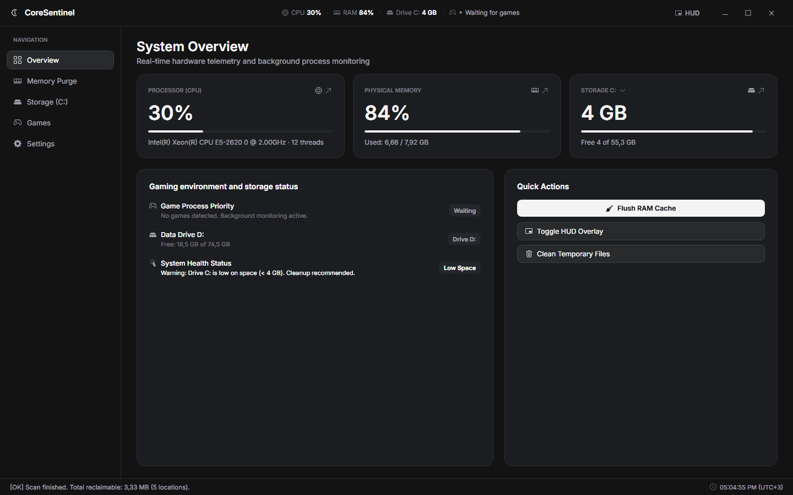

# CoreSentinel

[-0078D6)](https://github.com/levluklukyanov/core-sentinel)
[](https://dotnet.microsoft.com/)
[](https://docs.microsoft.com/dotnet/csharp/)
[](https://github.com/levluklukyanov/core-sentinel/releases)
[](LICENSE)

High-performance Windows system utility, real-time hardware telemetry monitor, and gaming resource manager built with C# 13 and .NET 10 (WPF).



---

## Overview

CoreSentinel provides real-time system monitoring, dual-engine memory and CPU optimization, game process prioritization, and disk maintenance within a single, lightweight desktop interface designed with engineering minimalism.

## Features

### Hardware Telemetry
- Real-time tracking of CPU load, RAM allocation, and storage drives via WMI and Win32 Native APIs.
- Detailed operation log with timestamps and horizontal navigation.

### Resource Optimization
- Memory purge: working set trimming via native Win32 `EmptyWorkingSet` API.
- CPU balancing: execution queue normalization and background process deprioritization.

### Game Sentinel
- Automatic detection of active game sessions with instant execution priority boost.
- Storage-wide game library scanner with duplicate exclusion and Minecraft launcher filtering.

### Storage Management
- Partition diagnostics and batch disk cleanup for temporary folders, update caches, error logs, and Windows Component Store maintenance via `DISM /StartComponentCleanup`.

### Floating Telemetry HUD
- Low-overhead, semi-transparent overlay widget for on-screen monitoring during gaming sessions and compute workloads.

### Interface & Ergonomics
- Clean Dark and Light themes adhering to Swiss modernist and engineering design principles.
- Tab Vault system to hide, restore, and reorder navigation tabs.
- Bundled system fonts: Golos Text, Inter, JetBrains Mono, Manrope, Onest.
- Persistent user configuration saved across application sessions.

---

## Memory Trimming & Honest Expectations

CoreSentinel uses the native Win32 `EmptyWorkingSet` API to trim memory working sets. This function requests Windows to move unreferenced pages from physical RAM into the standby pool or pagefile.

- **Realistic Effect:** Trimming working sets provides an immediate, observable reduction in reported RAM usage, which can be useful before launching demanding workloads or games.
- **No Magic Acceleration:** It does not magically accelerate Windows. As active applications demand their data, Windows will fault required pages back into physical RAM. During this transition, a brief increase in disk I/O may occur. CoreSentinel does not make unsubstantiated claims of "doubling PC speed".

---

## What the App Modifies in the System

CoreSentinel operates transparently and strictly modifies only documented system locations:

### 1. File System Cleanup Targets
- **User Space (Standard Rights):**
  - `%TEMP%` (Current user temporary directory)
  - `%LOCALAPPDATA%\CrashDumps` (User crash dump files)
  - `%LOCALAPPDATA%\Microsoft\Windows\WER\ReportArchive` and `ReportQueue` (User error reports)
  - `$Recycle.Bin` (Emptied via native Shell32 API across mounted volumes)
- **System Space (Requires Administrator Privileges):**
  - `%SystemRoot%\Temp` (Windows system temporary files)
  - `%SystemRoot%\SoftwareDistribution\Download` (Cached Windows update installation files)
  - `%SystemRoot%\SoftwareDistribution\DeliveryOptimization` (Peer-to-peer update distribution cache)
  - `%SystemRoot%\Logs\CBS` (Archived Component-Based Servicing logs; active `CBS.log` is strictly preserved)
  - `%ProgramData%\Microsoft\Windows\WER` (Machine-wide error report archives)
  - Windows Component Store: `dism.exe /Online /Cleanup-Image /StartComponentCleanup` to reclaim superseded WinSxS payloads. Note: CoreSentinel does not execute `/ResetBase` by default to preserve update rollback capabilities.

### 2. Windows Registry
- **Startup Manager:**
  - `HKCU\SOFTWARE\Microsoft\Windows\CurrentVersion\Run` and `StartupApproved\Run` (User autostart items).
  - `HKLM\SOFTWARE\Microsoft\Windows\CurrentVersion\Run` and `StartupApproved\Run` (Machine-wide autostart items; requires Administrator privileges).

### 3. Process Execution Priorities
- **CPU Optimization:** Temporarily lowers thread priority of select heavy background services (e.g., OneDrive, Dropbox, GoogleDriveSync, SearchIndexer) to `BelowNormal`.
- **Game Sentinel:** Elevates the execution priority of recognized active game processes to `High` to ensure consistent frame pacing.

### 4. Administrator Privileges (UAC)
The core application is fully operational under a standard, non-elevated user account for telemetry, working set trimming, user temp cleanup, and HKCU startup management. Deep system maintenance (Windows Temp, SoftwareDistribution, CBS logs, DISM, and HKLM registry modifications) requires running as Administrator via the built-in "Run as Admin" button.

---

## Windows SmartScreen and Antivirus Notice

CoreSentinel is a free, open-source utility distributed without an expensive commercial Extended Validation (EV) Code Signing certificate. Because the binary interacts with Win32 process APIs, system cleanup paths, and registry autostart keys, Windows SmartScreen ("Windows protected your PC") or certain antivirus heuristics may display an alert upon first launch.

The entire source code is 100% open, auditable, and can be built directly from source using the instructions below.

---

## Installation

1. Navigate to the [Releases](https://github.com/levluklukyanov/core-sentinel/releases) page.
2. Download the standalone executable `CoreSentinel.exe`.
3. Launch the application.

> **Note on executable size (~65 MB):**  
> The application is packaged as a Self-Contained Single-File binary. The complete .NET 10 runtime, native WPF dependencies, and typography assets are embedded directly into the executable. It runs out of the box on clean Windows 10/11 installations without requiring prior installation of the .NET SDK or Runtime packages.

---

## Building from Source

### Prerequisites
- Windows 10 / 11 (x64)
- [.NET 10.0 SDK](https://dotnet.microsoft.com/)

### Build Commands

```bash
# Clone the repository
git clone https://github.com/levluklukyanov/core-sentinel.git
cd core-sentinel

# Build the solution in Release configuration
dotnet build CoreSentinel.sln -c Release

# Publish standalone single-file binary
dotnet publish CoreSentinel.csproj -c Release -r win-x64 --self-contained true -p:PublishSingleFile=true -o ./publish
```
